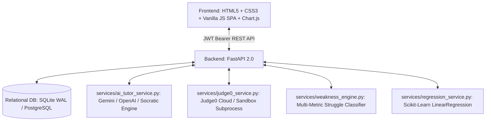

# SmartEdu ✦ AI-Powered Smart Learning & Coding Platform

> A full-stack, enterprise-grade educational productivity platform connecting teachers and students through syllabus-guided learning, multi-language coding execution via Judge0, Socratic AI tutoring, multi-dimensional student weakness detection, timed quiz assessments, and Scikit-Learn regression analysis.

---

## 📌 Architectural Overview



### Core Architecture & Tech Stack
- **Backend**: Python 3.10+ / 3.14+, FastAPI, SQLAlchemy 2.0 ORM, Pydantic v2, PyJWT, Passlib (Bcrypt).
- **Machine Learning**: Scikit-Learn `LinearRegression`, NumPy, SciPy for regression modeling and metric evaluation ($R^2$, MAE, RMSE).
- **Code Execution**: Judge0 API multi-language execution engine (Python, C, C++, Java, JavaScript, C#, PHP, Go, Rust) with strict resource limits and safe subprocess execution.
- **AI Tutoring**: Socratic AI tutor supporting Google Gemini (`gemini-1.5-flash`) and OpenAI (`gpt-4o-mini`) with pedagogical concept breakdown, hints, and error debugging.
- **Frontend**: Custom Responsive Design System (Light Theme: `#2563eb`, `#7c3aed`, `#10b981`), Vanilla JS SPA router, and Chart.js for 10 interactive performance graphs.
- **Database**: Normalized relational database supporting SQLite with Write-Ahead Logging (WAL) for local development, and PostgreSQL connection pooling for production.

---

## 📂 Project Structure

```text
├── config.py                 # Secure environment variable loader & validator
├── main.py                   # FastAPI application root, lifespan, and route mounts
├── requirements.txt          # Python dependencies
├── .env.example              # Environment variables template
├── .env                      # Local configuration file
├── start.bat                 # 1-Click Windows startup launcher
├── database/
│   ├── engine.py             # SQLAlchemy engine & session factory (SQLite WAL / Postgres)
│   ├── orm_models.py         # Relational schema (Users, Subjects, Units, Topics, Quizzes, Submissions)
│   └── seed_data.py          # Academic course and historical student seed database
├── routes/
│   ├── auth_routes.py        # JWT registration, login, and RBAC
│   ├── academic_routes.py    # Syllabus hierarchy (Subject -> Unit -> Chapter -> Topic)
│   ├── coding_routes.py      # Multi-language code execution & snippet management
│   ├── ai_routes.py          # Socratic AI tutor chat & weakness detection reports
│   ├── assessment_routes.py  # Quizzes, timed submissions, auto-grading & assignments
│   ├── analytics_routes.py   # Scikit-learn regression analysis & Chart.js graph feeds
│   └── notification_routes.py# In-app notifications & alerts
├── services/
│   ├── auth_service.py       # Bcrypt password hashing & JWT decoder
│   ├── judge0_service.py     # Real Judge0 API integration
│   ├── ai_tutor_service.py   # Google Gemini & OpenAI Socratic tutor engine
│   ├── weakness_engine.py    # Multi-indicator struggle classifier (High/Medium/Low)
│   └── regression_service.py # Scikit-Learn LinearRegression training & prediction
├── static/
│   ├── css/styles.css        # Modern educational light theme
│   └── js/app.js             # SPA client controller & Chart.js renderer
├── templates/
│   └── index.html            # Dual-portal (Student & Faculty) single-page interface
└── tests/
    ├── test_smartedu_platform.py # 18 platform automated test suites
    └── test_copilot_api.py       # 9 legacy test suites (100% backward compatible)
```

---

## 🚀 Quickstart & Execution

### 1. 1-Click Launch (Windows)
Double-click **`start.bat`** in the project directory. It launches the local server and opens **http://127.0.0.1:8000** in your browser.

### 2. Manual PowerShell Command
```powershell
cd "c:\Users\COMP\Desktop\finalproject\mp\New folder (2)"
.\venv\Scripts\Activate.ps1
python -m uvicorn main:app --reload --host 127.0.0.1 --port 8000
```

### 3. Running Automated Tests
```powershell
.\venv\Scripts\pytest.exe tests/
```
*(All 27 automated tests pass with 100% success).*

---

## 🔑 Default Accounts (Initial Seed Data)

| Role | Email | Password | Details |
|---|---|---|---|
| **Student** | `student.alex@smartedu.edu` | `Student@2026` | Enrolled in CS401 & CS402, 5 historical assessments for regression |
| **Teacher** | `prof.sharma@smartedu.edu` | `Teacher@2026` | Faculty in CSE, manages subjects and quizzes |
| **Admin** | `admin@smartedu.edu` | `Admin@SecurePass2026` | System-wide administrative permissions |
